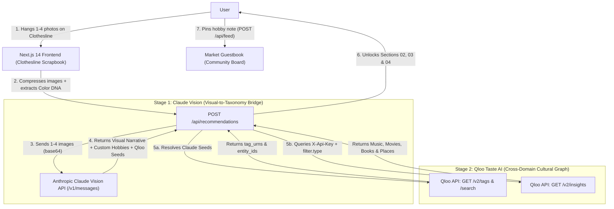

# Visual 🍀 Hobby Market — Powered by Claude Vision + Qloo Taste AI™

A cozy full-stack web application built for the **Qloo Hackathon** that transforms passive visual inspiration (1–4 screenshots, Pinterest boards, room/outfit photos) into active lifestyle hobbies and cross-domain cultural recommendations powered by **Claude Vision** (as the Multimodal Visual-to-Taxonomy Input Bridge) and **Qloo Taste AI™** (`https://hackathon.api.qloo.com`).

---

## 🧠 Why Claude Vision + Qloo Taste AI™?

Qloo excels at cross-domain cultural affinity using entities and tags from its taxonomy—not raw pixels. Previously, users had to manually translate their visual intuition into static tags like `"botanical"` or `"y2k retro"`.

**Visual Hobby Market solves this bottleneck with a two-stage pipeline:**
1. **🔭 Stage 1 — Claude Vision (The Multimodal Input Bridge)**:
   - Reads the user's 1–4 uploaded photos directly from the clothesline.
   - Captures subtle visual nuances that fixed tags miss (e.g., *"Warm late-afternoon sunlight in a tiled kitchen with hanging pothos and speckled ceramic mugs"*).
   - Translates the visual mood into **Qloo Taxonomy Seeds**:
     - **`tag_queries`** for Qloo's `/v2/tags` endpoint (genres, styles, moods).
     - **`entity_queries`** for Qloo's `/search` endpoint (probable anchor artists, film directors, books, and cultural icons).
   - Generates **3 tailored, actionable hobbies** with custom **Starter Kits** born directly from the visual details in the user's photos.
2. **🍀 Stage 2 — Qloo Taste AI™ (The Cross-Domain Cultural Graph)**:
   - Resolves Claude's semantic seeds into official Qloo Tag URNs (`GET /v2/tags`) and Entity UUIDs (`GET /search`).
   - Queries `GET /v2/insights` across `urn:entity:artist`, `urn:entity:movie`, `urn:entity:book`, and `urn:entity:place` to return real cross-domain cultural recommendations.

---

## 🏗️ Architecture (Mermaid Diagram)



---

## 🚀 Quick Start & Environment Variables

Copy `.env.example` to `.env` (or add these in **Vercel → Environment Variables**):

```env
QLOO_API_KEY=your_qloo_hackathon_api_key_here
QLOO_BASE_URL=https://hackathon.api.qloo.com
ANTHROPIC_API_KEY=your_anthropic_claude_api_key_here
CLAUDE_MODEL=claude-sonnet-4-20250514
```

### Run Frontend + Built-in API Routes (Next.js 14)
```powershell
cd frontend
npm install
npm run dev
```
Open **[http://localhost:3000](http://localhost:3000)** in your browser.
