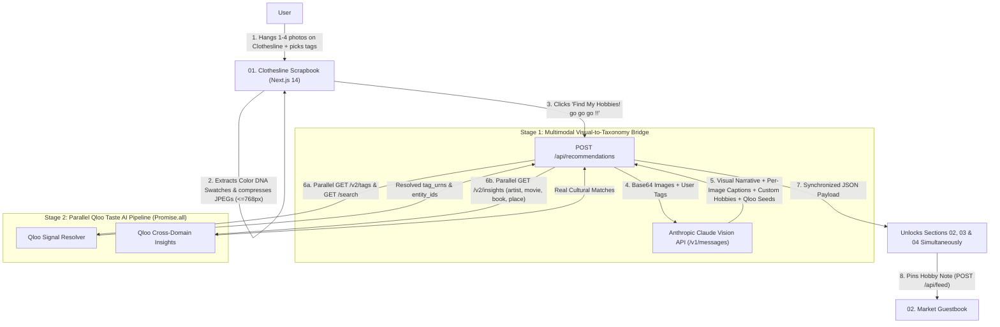

# Visual 🍀 Hobby Market — Powered by Claude Vision + Qloo Taste AI™

**Visual Hobby Market** is a full-stack web application built for the **Qloo Hackathon** that turns passive visual inspiration (1–4 screenshots, Pinterest pins, room corners, outfit/craft photos) into active, hands-on lifestyle hobbies and cross-domain cultural recommendations powered by **Claude Vision** and **Qloo Taste AI™** (`https://hackathon.api.qloo.com`).

---

## 💡 The Core Thesis: Why Claude Vision + Qloo Taste AI™?

**Qloo Taste AI™** is unmatched at computing cross-domain cultural affinity across music, film, books, and places—but Qloo's API operates on **structured entities and taxonomy tags**, not raw images. Previously, users had to manually translate their visual intuition into generic tags like `"botanical"` or `"indie cinema"`, creating a perceptual bottleneck at the input.

**Visual Hobby Market solves this with a clean division of responsibilities:**

1. **🔭 Stage 1 — Claude Vision (The Multimodal Input Bridge)**:
   - Inspects the user's **1 to 4 uploaded photos** hung on the clothesline together with their selected/custom aesthetic tags.
   - Captures subtle visual nuances that static tags cannot express (e.g., *"Warm late-afternoon sunlight filtering through trailing pothos in a tiled kitchen, paired with speckled handmade stoneware"*).
   - Translates visual details directly into **Qloo Taxonomy Seeds**:
     - **`tag_queries`**: Style, genre, and mood keywords mapped for Qloo's `GET /v2/tags` endpoint.
     - **`entity_queries`**: Real-world anchor entities (artists, directors, books, cultural landmarks) mapped for Qloo's `GET /search` endpoint.
   - Generates **per-photo micro-captions** on the clothesline and **3 custom, actionable hobbies** with tailored **3-item Starter Kits**.

2. **🍀 Stage 2 — Parallelized Qloo Taste AI™ (The Cross-Domain Cultural Graph)**:
   - Concurrently resolves Claude's semantic seeds into official Qloo Tag URNs (`GET /v2/tags`) and Entity UUIDs (`GET /search`) using `Promise.all`.
   - Fires parallel `GET /v2/insights` queries across four cultural domains (`urn:entity:artist`, `urn:entity:movie`, `urn:entity:book`, `urn:entity:place`) to deliver real cross-domain recommendations in ~1.5 seconds.

---

## ✨ Key UX & Product Features

- **🧺 `01. Your Clothesline Scrapbook` (Focused Entry & Manual Unlock)**:
  - Starts with a clean, uncluttered view. Users hang 1–4 photos on an illustrated clothesline with wooden clothespins.
  - Automatically extracts **🎨 Color DNA Hex Swatches** from the uploaded images.
  - Users can mix & match cozy aesthetic trinket tags (`botanical`, `ceramics & clay`, `analog photography`, `lo-fi jazz`, `anime & illustration`, `vintage vinyl`, `urban architecture`, `cozy reading`, `indie cinema`, `retro gaming`) or add custom tags (`+ TAG`).
  - Sections **02, 03, and 04** stay tucked away until the user clicks **`✨ Find My Hobbies! go go go !! →`**, then reveal simultaneously once the parallel pipeline completes.
- **🍀 `02. Your Cozy Vibe Check`**:
  - Displays the user's **Aesthetic Persona**, the **`🔭 Visual Reading (Input Bridge)`** narrative, and the **`🎯 Translated Seeds for Qloo Taxonomy`** (`Anchor Entities` + `Taxonomy Tags`), plus a one-click **`📋 Copy My Market Card Summary`** button.
- **🎵 `03. Your Qloo Mixtape & Top Picks`**:
  - Dedicated cross-domain cultural explorer with interactive filter pills (`✦ All`, `🎵 Music`, `🎬 Movies`, `📖 Books`, `📍 Places`).
- **✨ `04. Unlocked Hobbies & Trinkets Powered by Qloo`**:
  - 3 actionable hobby cards featuring match scores, step-by-step descriptions, a **`🧺 Starter Kit to Begin`**, a **`🎵 Paired Qloo Companion`** badge, and a one-click button to pin the hobby to the community board.
- **💌 `02. Market Guestbook`**:
  - Interactive community board where users post notes about the hobbies they are starting and give likes (`♥`).
- **🔍 Discreet Hackathon Judge Mode**:
  - Collapsible bottom inspector showing the live step-by-step technical log of the **Claude Vision → Qloo `/v2/tags` & `/search` → Qloo `/v2/insights`** pipeline.

---

## 🏗️ System Architecture



---

## 🚀 Quick Start (Local & Vercel Deployment)

### 1. Environment Variables
Copy [`.env.example`](.env.example) to `.env` (and `frontend/.env.local` for local Next.js dev, or add them in **Vercel → Settings → Environment Variables**):

```env
QLOO_API_KEY=your_qloo_hackathon_api_key_here
QLOO_BASE_URL=https://hackathon.api.qloo.com
ANTHROPIC_API_KEY=your_anthropic_claude_api_key_here
CLAUDE_MODEL=claude-haiku-5-5
```

### 2. Run Locally (Next.js 14 Full-Stack App)
```powershell
cd frontend
npm install
npm run dev
```
Open **[http://localhost:3000](http://localhost:3000)** in your browser.

### 3. Deploy on Vercel
1. Import this repository in **Vercel**.
2. Select **`frontend` (`Next.js`)** → **`Import single project →`**.
3. Add `QLOO_API_KEY`, `QLOO_BASE_URL`, and `ANTHROPIC_API_KEY` under **Environment Variables**.
4. Click **Deploy**.
