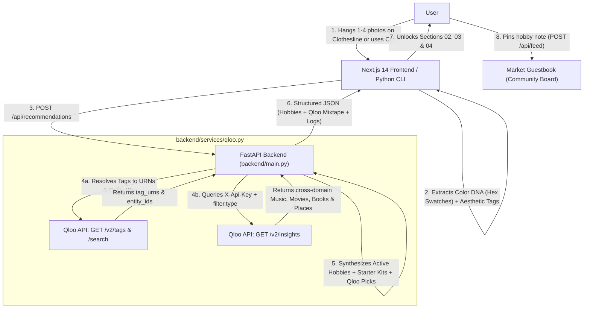

# Visual 🍀 Hobby Market — Powered by Qloo Taste AI™

A cozy full-stack web application and CLI built for the **Qloo Hackathon** that transforms passive visual inspiration (1–4 screenshots, Pinterest boards, outfit/room photos) into active lifestyle hobbies and cross-domain cultural recommendations powered by Qloo (`https://hackathon.api.qloo.com`).

---

## ✨ Key Features

- **🧺 Clothesline Visual Scrapbook (`01. Your Clothesline Scrapbook`)**: Drag & drop 1 to 4 images onto a cozy clothesline with wooden clothespins. Extracts dominant RGB/Hex **Color DNA Swatches** and visual aesthetic tags (`botanical`, `anime`, `kawaii pop`, `y2k retro`, `analog photography`, `lo-fi jazz`, `cyberpunk`, `dark academia`, `indie sleaze`, plus custom user tags).
- **🍀 Progressive Cozy Reveal**: Starts with a clean, focused scrapbook card and progressively unlocks:
  - **`02. Your Cozy Vibe Check`**: Aesthetic persona archetype, personalized summary, and one-click **"📋 Copy My Market Card Summary"** to share.
  - **`03. Your Qloo Mixtape & Top Picks`**: Cross-domain cultural picks (`🎵 Music`, `🎬 Movies`, `📖 Books`, `📍 Places`) with category filter pills.
  - **`04. Unlocked Hobbies & Trinkets Powered by Qloo`**: Actionable hobby cards with match scores, **Starter Kits**, and **Qloo Cultural Picks**.
- **💌 Market Guestbook (`02. Market Guestbook`)**: Community board where users pin the hobbies they are starting and give likes (`♥`) to fellow explorers.
- **🔍 Discreet Hackathon Judge Mode**: Collapsible bottom inspector showing the live two-step Qloo API request log (`/v2/tags` + `/search` → `/v2/insights`).

---

## 🏗️ Architecture (Mermaid Diagram)



---

## 🚀 Quick Start

### 1. Environment Variables (`.env`)
Copy `.env.example` to `.env` in the root folder (`qloo-y2k-app/.env` is protected by `.gitignore`) and add your Qloo Hackathon API Key:

```env
QLOO_API_KEY=your_qloo_hackathon_api_key_here
QLOO_BASE_URL=https://hackathon.api.qloo.com
FRONTEND_URL=http://localhost:3000
```

### 2. Start Backend (FastAPI + CLI)
```powershell
cd backend
python -m venv venv
.\venv\Scripts\activate
pip install -r requirements.txt

# Run FastAPI server on http://localhost:8000
uvicorn main:app --reload --port 8000

# Or test via the Terminal CLI:
python cli.py --tags "botanical,anime,y2k retro"
```

### 3. Start Frontend (Next.js 14 + Tailwind CSS)
```powershell
cd frontend
npm install
npm run dev
```
Open **[http://localhost:3000](http://localhost:3000)** in your browser.
